# 같은 비, 다른 피해 — 기후 취약 상권 진단과 호우 지수형 손실보전

> **2026 빅콘테스트 AI데이터분석 분야 · 개인 참가 (j2tori · 전건우) · 2026.10**
>
> 카드 매출·통신 유동인구·기상·지하철 데이터를 하나의 패널로 묶어,
> **어떤 날씨가, 어떤 상권에, 얼마나 '사라지는' 피해를 주는지** 측정하고
> 피해 유형에 맞는 **예보 기반 우선지원 + 호우 지수형 자동 손실보전**을 설계했습니다.

<p align="center">
  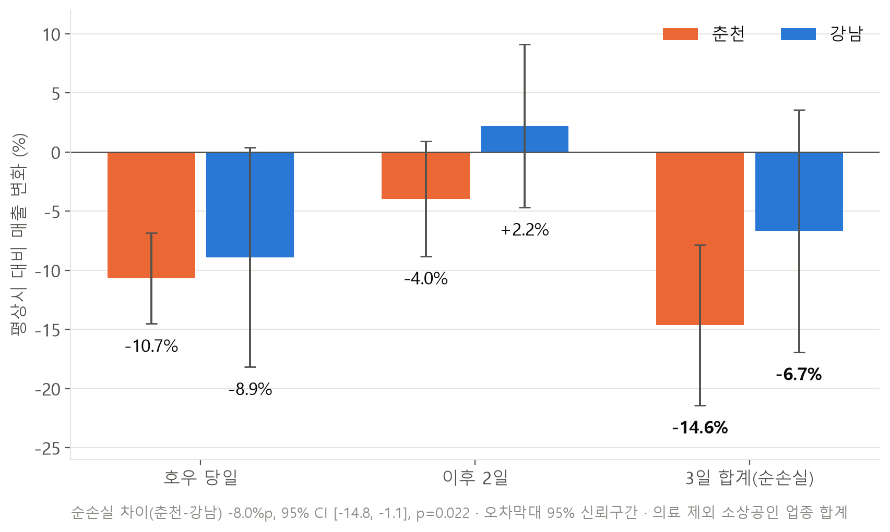
</p>

## 한눈에 보기

| 핵심 수치 | 의미 |
|---|---|
| **−14.6%** | 호우(30mm+) 때 춘천 소상공인의 3일 순손실. 강남(−6.7%)의 2배, 차이 −8.0%p (p = 0.022) |
| **0.0%** | 폭염일(33℃+) 매출 효과. 기후 충격은 폭염이 아니라 **호우**에서 온다 |
| **−13.7%** | 춘천 호우일 지하철 도착 인원. 강남은 −0.4%로 변화 없음 |
| **56%** | 춘천 매출 감소 중 '사람이 오지 않아서' 생긴 몫 (95% 범위 28~90%) |
| **187억 원** | 2025 하반기 6개월간 호우로 사라진 춘천 소상공인 매출 (매출의 1.4%) |
| **0.74** | 학습에 쓰지 않은 호우 이벤트에서 지수형 지급액과 실제 손실의 상관 (춘천 14건) |

**결론:** 같은 비에도 춘천은 **발길이 끊기는 '유입 차단형'**, 강남은 **사람은 오는데 지갑이 닫히는 '소비 위축형'** 상권이다. 그래서 처방도 달라야 한다.

---

## 1. 문제 정의

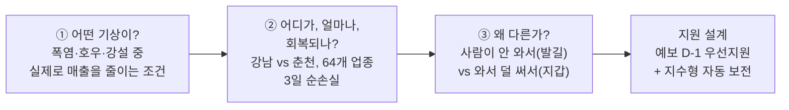

## 2. 데이터와 파이프라인

| 데이터 | 단위 | 쓰임 |
|---|---|---|
| 신한카드 매출 (대회 제공) | 일 × 지역 × 업종, 고객 거주지·성·연령·6시간대, **약 285만 행** | 매출 충격 측정 |
| SK텔레콤 유동인구 (대회 제공) | 50m 격자 × 요일·시간대·성연령 (월 평균) | 방문형 상권 지수 |
| 기상청 ASOS (공공) | 서울(108)·춘천(101) 일·시간 자료 | 호우·폭염·강설 정의 |
| 서울시 지하철 승하차 (공공, OA-12914) | 역별 일별 하차, 춘천 6개 역·강남구 25개 역 | 발길(유입) 측정 |

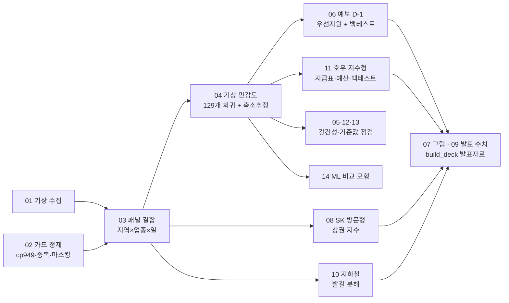

**정제 단계에서 먼저 막은 함정 5가지**

| 문제 | 처리 | 결과 |
|---|---|---|
| SK 12월 파일 행 2배 중복 | 운영사무국 공지대로 중복 제거 | 12.1만 행 제거 |
| 카드 5건 미만 셀 마스킹 | 미관측일은 0이 아닌 결측으로 유지, 호우일 편향 점검 | 손실 과대추정 최대 1.5%p |
| 춘천 ASOS 일 적설 공란 | 시간 적설심으로 신적설 복원 (서울 공식값과 일치 검증) | 강설 3일 복원 |
| 기후와 무관한 업종 혼재 | 세금·보험·PG 제외, 의료는 필수서비스로 분리 | 90개 → 소상공인 64개 |
| 추석 연휴와 호우 중첩 | 연휴 통제 + 추석 제외 재분석 | 결론 유지 (p = 0.045) |

## 3. 분석 설계

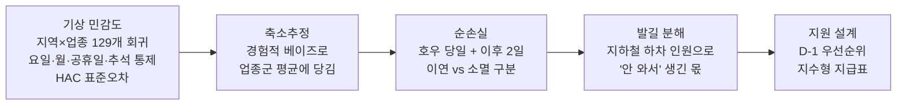

검증: 호우 이벤트 27건 단위 교차검증 · 지역 합계 회귀 검산 · 추석 제외 재분석 · 마스킹 편향 점검 · 알고리즘·지급액 백테스트

## 4. 주요 발견

### 폭염이 아니라 비

| 폭염일(33℃+) 효과 | 호우일(30mm+) 효과 |
|---|---|
| 춘천 0.0% / 강남 −0.9% (유의하지 않음) | 춘천 −10.7% (95% CI −14.5 ~ −6.8) |

<p align="center">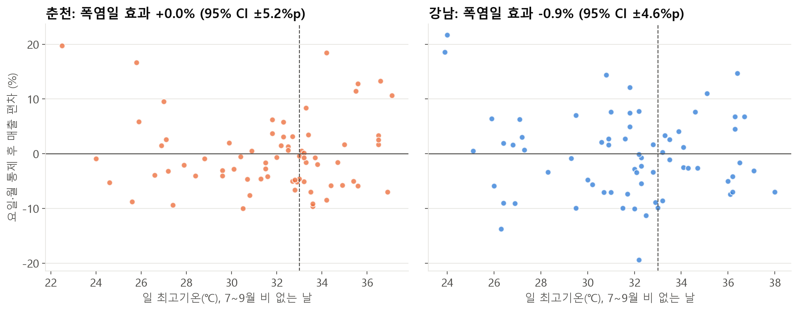</p>

### 비가 그친 뒤 강남은 돌아오고, 춘천은 반등이 없다

<p align="center">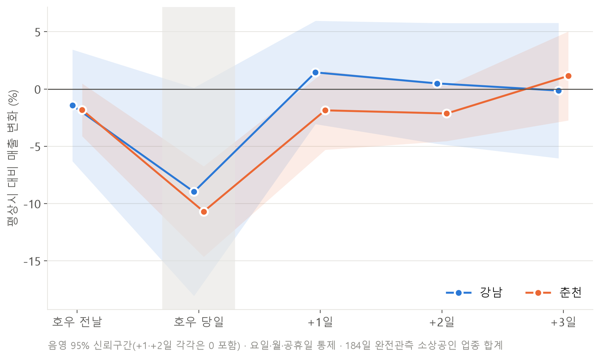</p>

- 강남 식료품처럼 다음 날 반등하는 **미뤄지는 손실**은 지원이 필요 없고,
- 춘천 생활소매·외식처럼 반등이 없는 **사라지는 손실**이 지원 대상이다.

### 비는 '찾아오는 손님'을 먼저 막는다

<p align="center">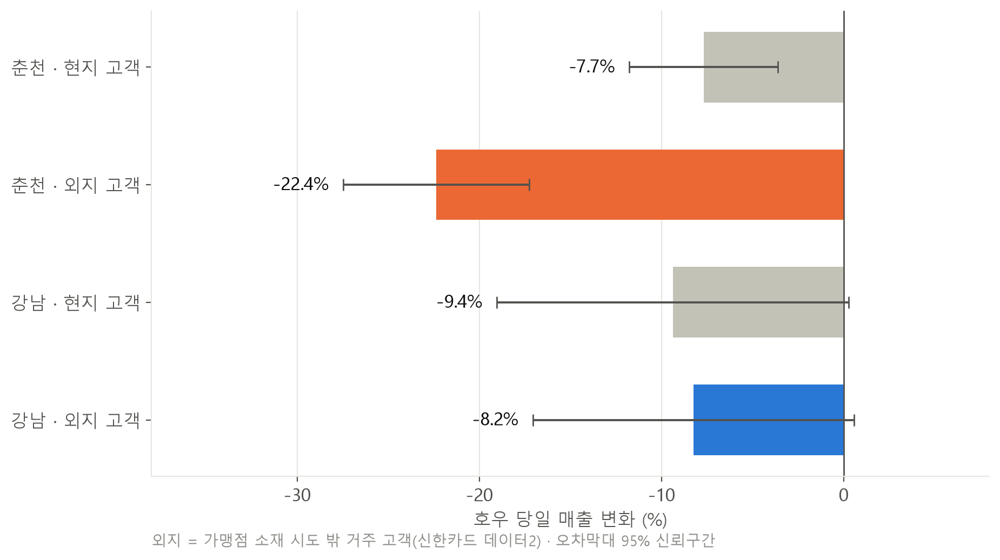</p>

춘천 외지 고객 매출 −22.4% vs 현지 −7.7% (3배). 강남은 둘 사이 차이가 없다.

### 춘천은 발길이 끊기고, 강남은 지갑이 닫힌다

<p align="center">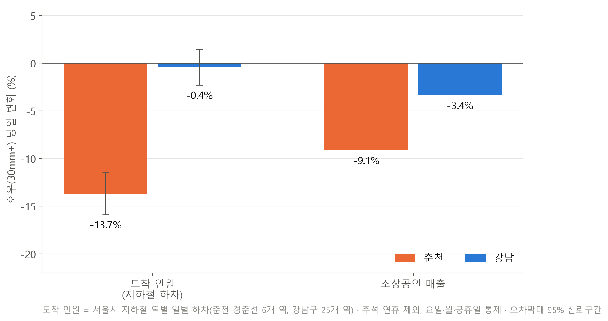</p>

<p align="center">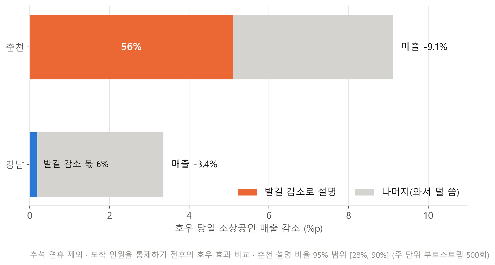</p>

춘천 매출 감소의 **56%** 는 도착 인원 감소로 설명된다. 강남은 6%뿐이다.

### 통신 데이터로 본 '찾아오는 상권'

<p align="center">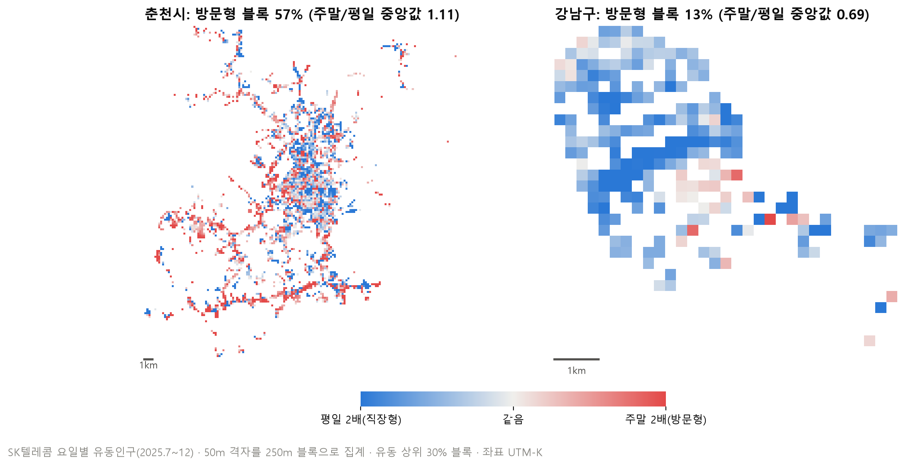</p>

방문형 상권 블록 비중은 춘천 57%, 강남 13%다.

### 진단: 취약 상권의 두 유형

| | **유입 차단형 — 춘천** | **소비 위축형 — 강남** |
|---|---|---|
| 호우일 도착 인원 | −13.7% | −0.4% |
| 외지 고객 매출 | −22.4% | −8.2% |
| 3일 순손실 | −14.6% | −6.7% (불확실) |
| 방문형 상권 블록 | 57% | 13% |
| **처방** | 지수형 자동 보전 + 비 그친 뒤 재방문 유도 | 보전보다 배달·온라인 판로, 소비 진작 |

### 피해 규모

<p align="center">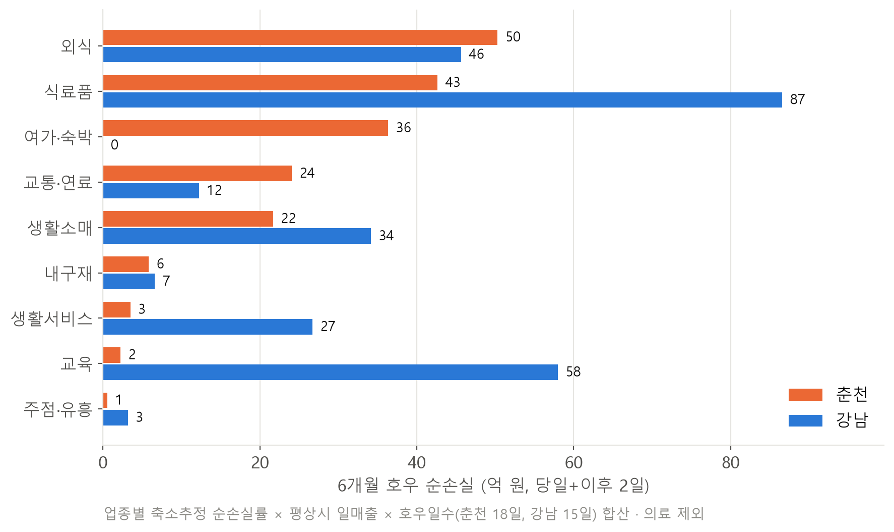</p>

6개월 순손실은 춘천 187억 원(매출의 1.42%), 강남 273억 원(0.43%, 95% 범위가 0을 포함)이다. 신한카드 오프라인 결제 기준이라 실제 피해는 이보다 크다.

## 5. 모델 신뢰성

| 점검 | 결과 |
|---|---|
| 축소추정 | 춘천 56개 업종의 업종 간 추정 편차 17.7 → 10.9%p. 예식장 개별 추정 +46% → 업종군 보정 −1% |
| 호우 27건 교차검증 (호우 당일 WAPE) | 춘천: 축소추정 회귀 **16.1%** < 부스팅 16.9% < 달력만 19.1% · 강남: 부스팅 **20.6%** < 축소추정 24.3% < 달력만 27.2% |
| 역할 분담 | 예측은 부스팅을 함께 쓸 수 있고, 지급 기준·지급률은 해석 가능한 회귀로 정함 |

<p align="center">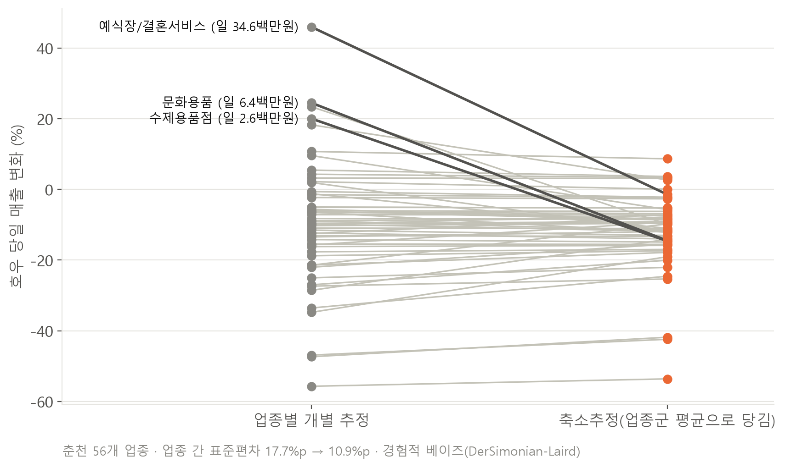 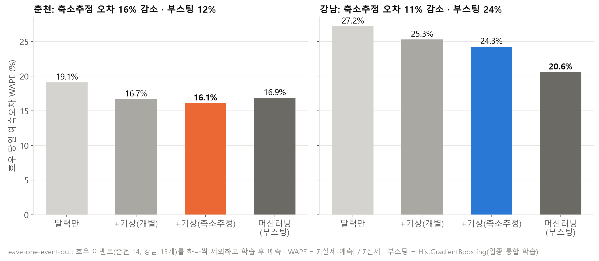</p>

## 6. 정책 설계 — 예보 D-1 알림부터 D+1 자동 보전까지

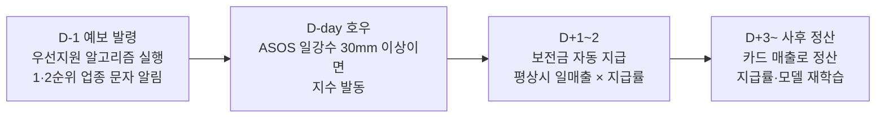

| 구성 | 내용 |
|---|---|
| **우선지원 점수** | 예상 순손실 = 업종별 손실률 × 평상시 일매출 → 규모·손실률·회복불가 = 4:4:2 → 단측 95% 손실 확실 업종만 1·2순위 |
| **지수형 보전** | 손해사정·서류 없이 강수량 지수로 발동. 지급률 = 3일 순손실률 × 50% (자기부담 50%로 도덕적 해이 방지) |
| **지급 대상** | 손실이 확실한 업종만 (춘천 30/56개, 강남 8/63개). 이연형·영향 미미 업종 제외 |
| **예산** | 춘천 1회 발동 4.1억 원, 6개월(호우 18일) 75억 원 = 순손실 187억의 40% |
| **백테스트** | 춘천 우선지원 적중 33% (무작위 18%), 가중치를 바꿔도 상위 10개 82~92% 유지 |

<p align="center">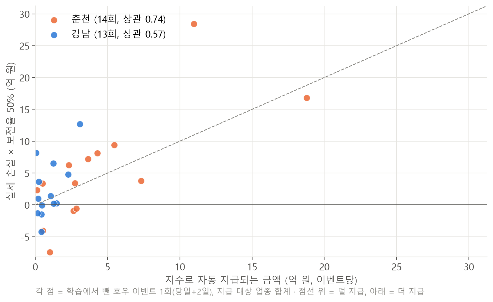</p>

학습에 쓰지 않은 호우 이벤트에서 지급액과 실제 손실의 상관은 춘천 0.74(총지급/실손 83%), 강남 0.57(39%)이다. 즉 지수형 보전은 **유입 차단형 상권에 맞고 소비 위축형에는 맞지 않는다.**

## 7. 검증과 한계

| 결론이 유지되는가 | |
|---|---|
| ✓ 추석 기간 제외 | 순손실 차이 −9.1%p (p = 0.045), 도착 −13.7% 유지 |
| ✓ 마스킹 편향 | 호우일 누락 증가 없음 (p > 0.5), 과대추정 ≤ 1.5%p |
| ✓ 업종 구성 고정 | 184일 완전관측 업종만 써도 동일 |
| ✓ 호우 기준 40·50mm | 춘천 손실·발길 감소 유지 (지역 차이는 30mm에서만 유의) |

| 한계 | |
|---|---|
| 기간 6개월 | 장마 1회뿐. 지수 보전 예산은 수년치 강수로 다시 산정해야 함 |
| 지하철 = 교통카드 기준 | ITX·자가용 방문객 제외, 하차 인원에 귀가 주민 포함 |
| 유동인구는 월 평균 | 일별 효과는 카드·지하철로만 측정, 유동인구는 노출도 지표로만 사용 |
| 강남 우선순위 적중률 | 백테스트 19% vs 무작위 16% → 강남은 업종 선별보다 소비 진작이 맞음 |

---

## 저장소 구성

| 경로 | 내용 |
|---|---|
| `src/` | 01 기상 수집 → 02·03 카드 정제·패널 결합 → 04·05 민감도·강건성 → 06 우선지원 → 07 그림 → 08 SK → 09 발표 수치 → 10 지하철 → 11 지수형 보전 → 12·13 기준값 민감도 → 14 ML 비교, `config.py` |
| `outputs/figures/`, `outputs/figures_slide/` | 분석용·발표용 그림 F1~F14 |
| `presentation/` | 결과보고서(PDF·PPTX), LLM 활용 설명자료, 발표자료 생성 스크립트 `build_deck.py` |
| `설명자료/` | 상세 해설서, 쉬운 설명, 심사 예상 질문 |

> **데이터는 포함하지 않았습니다.** 신한카드·SK텔레콤 데이터는 대회 제공 자료로 재배포가 금지되어 있어 원본·가공본(`data/`)과 결과 CSV를 모두 제외했습니다. 집계된 결과 그림과 보고서만 공개합니다.

## 실행 방법

프로젝트 루트에서 순서대로 실행합니다. 대회 제공 데이터를 `data/` 아래에 두어야 합니다.

```bash
python src/01_fetch_weather.py          # KMA_API_KEY 필요 (개발용: --source openmeteo)
python src/02_build_card_panel.py
python src/03_build_panel.py
python src/04_model_sensitivity.py      # 업종별 민감도(축소추정)·순손실률·이벤트 단위 검증
python src/05_robustness_checks.py      # 지역 단위 순손실·지역 차이 검정, 마스킹 편향 점검
python src/06_priority_algorithm.py     # 예보 기반 우선지원 알고리즘·백테스트·가중치 민감도
python src/14_ml_benchmark.py           # 머신러닝 비교 모형 (07 전에 실행)
python src/07_figures.py                # 발표용 그래프
python src/08_sk_flow.py                # SK 유동인구 방문형 상권 지수·지도(F10)
python src/10_subway_flow.py            # 지하철 도착 인원·매출 감소 원인 분해(F12·F13)
python src/11_index_payout.py           # 호우 지수형 지급표·예산·백테스트(F14)
python src/09_report_numbers.py         # 발표자료 핵심 숫자 모음 (10·11·14 다음에 실행)
python src/12_threshold_sensitivity.py  # (점검) 호우 기준 30·40·50mm 민감도
python src/13_count_threshold_sensitivity.py  # (점검) 분석 대상 업종 기준 민감도
python presentation/build_deck.py       # 발표자료 PPT
```

필요 패키지: pandas, numpy, statsmodels, scikit-learn, matplotlib, seaborn

### 정제 규칙

- 카드 원본 cp949, 연령 표기 공백 제거 ('20 대' → '20대')
- 업종 분류·분석 범위: `src/config.py`의 `INDUSTRY_GROUPS`
- 고객 구분: 거주 시도가 가맹점 시도와 같으면 현지, 다르면 외지, '정보없음'은 unknown
- 체감온도: 기상청 식 (5~9월 여름철 식, 그 외 겨울철 풍속냉각)
- 분석 기본 대상: `scope == "core"` & `reliable == 1`. `observed == 0`(마스킹, 5건 미만)인 날은 매출을 NaN으로 둔다

### 외부 데이터 출처

- 기상청 지상(종관, ASOS) 일자료·시간자료 조회서비스, 공공데이터포털(data.go.kr), 지점 108(서울)·101(춘천), 2025-06-28~2026-01-01
- 서울시 지하철호선별 역별 승하차 인원 정보(교통카드 기준), 서울 열린데이터광장 OA-12914, 공공누리 제1유형. 2025년 7~12월 월별 파일
- 풍수해보험 보상 범위: 행정안전부 소상공인 풍수해보험 안내 (정책 배경 설명에만 사용)
- 공휴일: 관보 고시 기준, `src/config.py`의 `HOLIDAYS`

### 생성형 AI 활용

Claude로 코드·자료 초안을 작성했고, 모든 수치는 제출 코드로 재현하며 결과는 직접 검증했습니다. 상세 내용은 `presentation/데이터분석분야_j2tori_LLM활용설명자료.pdf`에 있습니다.

---

**기술:** Python · pandas · statsmodels(HAC 회귀) · 경험적 베이즈 축소추정 · scikit-learn(그래디언트 부스팅) · matplotlib · 매개 분석 · 이벤트 스터디

---

👤 [전건우 GitHub 프로필](https://github.com/j2tori-design) · 📂 [전체 프로젝트 목차](https://github.com/j2tori-design/contest-portfolio)
